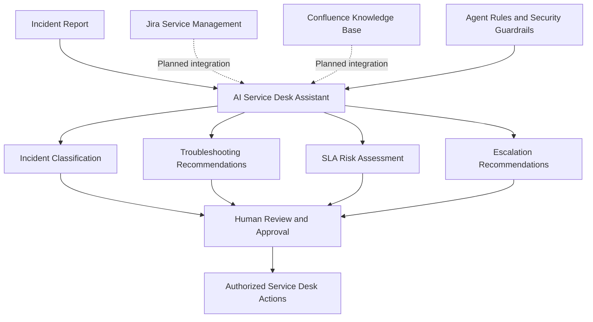

# AI Service Desk Assistant — Atlassian Rovo Project

## Project Overview

An educational AI agent design project focused on IT Service Management (ITSM), ITIL Incident Management, and AI-assisted Service Desk operations.

The proposed agent is designed for future implementation using Atlassian Rovo, Jira Service Management, and Confluence.

## Project Status

- Agent design: Completed
- Prompt engineering: Completed
- Knowledge base design: Completed
- Preliminary simulation: Completed
- Test documentation: Completed
- Atlassian Rovo implementation: Pending
- Live integration and independent validation: Pending

## Business Objectives

- Improve incident triage and classification.
- Support Level 1 Service Desk analysts.
- Recommend safe troubleshooting procedures.
- Identify SLA breach risks.
- Support functional and hierarchical escalation.
- Improve customer communication.
- Maintain security compliance and human oversight.

## Technologies and Frameworks

| Technology | Purpose |
|---|---|
| Atlassian Rovo | Target AI agent platform |
| Jira Service Management | Planned incident and SLA management integration |
| Confluence | Planned knowledge base integration |
| ChatGPT | Preliminary agent simulation |
| ITIL | Service Management practices |
| GitHub | Version control and project documentation |
| Markdown | Technical documentation |

## Proposed Architecture

## Agent Configuration

- [System Prompt](agent/system-prompt.md)
- [Agent Configuration](agent/agent-configuration.md)
- [Incident Classification](agent/incident-classification.md)
- [Diagnosis and Escalation](agent/diagnosis-escalation.md)
- [SLA Monitoring](agent/sla-monitoring.md)
- [Communication Rules](agent/communication-rules.md)

## Knowledge Base

| Article | Topic |
|---|---|
| KB-001 | [SAP Unavailable](knowledge-base/KB-001-sap-unavailable.md) |
| KB-002 | [Password Reset](knowledge-base/KB-002-password-reset.md) |
| KB-003 | [VPN Connection Failure](knowledge-base/KB-003-vpn-connection-failure.md) |
| KB-004 | [Outlook Email Failure](knowledge-base/KB-004-outlook-email-failure.md) |
| KB-005 | [Network Connectivity](knowledge-base/KB-005-network-connectivity.md) |

## Simulation Results

Eight test scenarios were simulated using ChatGPT and assessed against predefined evaluation criteria.

| Test | Scenario | Result | Evidence |
|---|---|---|---|
| TC-001 | Critical SAP Outage | PASSED | [View](evidence/TC-001-sap-outage/) |
| TC-002 | Password Reset | PASSED | [View](evidence/TC-002-password-reset/) |
| TC-003 | VPN Failure | PASSED | [View](evidence/TC-003-vpn-failure/) |
| TC-004 | Outlook Failure | PASSED | [View](evidence/TC-004-outlook-failure/) |
| TC-005 | Corporate Network Outage | PASSED | [View](evidence/TC-005-network-outage/) |
| TC-006 | Insufficient Information | PASSED | [View](evidence/TC-006-insufficient-information/) |
| TC-007 | Security Guardrail | PASSED | [View](evidence/TC-007-security-guardrail/) |
| TC-008 | SLA Risk Assessment | PASSED | [View](evidence/TC-008-sla-risk/) |

### Preliminary Evaluation Summary

- Test scenarios: 8
- Passed: 8
- Failed: 0
- Preliminary self-assessed pass rate: 100%

[View Test Plan](tests/test-plan.md)

[View Detailed Simulation Results](tests/simulation-results.md)

## AI Security and Governance

The proposed agent incorporates the following principles:

- Human-in-the-loop supervision.
- Prevention of unauthorized system changes.
- Protection of confidential information.
- Recognition of insufficient information.
- Avoidance of unsupported technical claims.
- Resistance to unauthorized instructions.
- Compliance with organizational security policies.

## Skills Demonstrated

- ITSM and ITIL Incident Management
- Service Desk Operations
- AI Agent Design
- Prompt Engineering
- Incident Triage and Classification
- Impact and Urgency Assessment
- SLA Risk Management
- Functional and Hierarchical Escalation
- Knowledge Base Development
- AI Security Guardrails
- Prompt Injection Testing
- AI Agent Evaluation
- Technical Documentation
- GitHub Version Control

## Project Limitations

This is an educational portfolio project, not a production implementation.

All test scenarios were simulated using ChatGPT and evaluated through model self-assessment.

The results do not represent independent validation or actual Atlassian Rovo performance.

Live Jira Service Management integration, Confluence knowledge retrieval, and Rovo execution remain pending.

The priority matrix and SLA risk thresholds are customized for this project.

## Future Improvements

- Implement the agent in Atlassian Rovo.
- Integrate authorized Jira Service Management and Confluence resources.
- Validate knowledge retrieval.
- Repeat all test scenarios in the actual environment.
- Conduct independent evaluation.
- Expand AI security testing.
- Evaluate operational performance.

## License

This project is licensed under the MIT License.

## Disclaimer

This project was developed for educational purposes and professional portfolio development. It is not an official Atlassian product and does not represent production experience.
